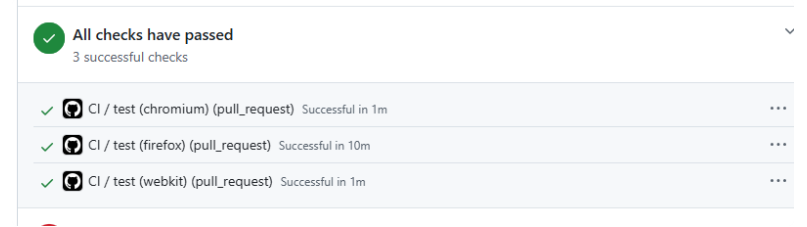
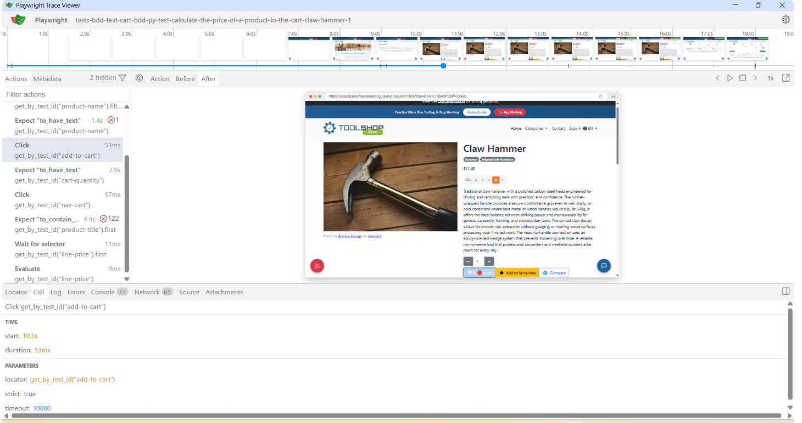

# Toolshop Automation Testing – SonSy


## 1. Giới thiệu dự án

Dự án **Toolshop Automation Testing** được xây dựng nhằm thực hành kiểm thử tự động website Toolshop bằng Python, Pytest và Playwright.

Trong Sprint 2B, nhóm tập trung vào việc áp dụng **Behavior-Driven Development (BDD)**, triển khai **Continuous Integration (CI)** bằng GitHub Actions và kiểm thử trên nhiều trình duyệt.

## 2. Mục tiêu Sprint 2B

- Xây dựng kịch bản kiểm thử theo cú pháp Gherkin.
- Sử dụng `pytest-bdd` để liên kết kịch bản với mã kiểm thử Python.
- Kiểm tra phép tính giá sản phẩm trong giỏ hàng với nhiều số lượng khác nhau.
- Sử dụng Page Object Model (POM) để tổ chức mã nguồn.
- Thiết lập môi trường Toolshop bằng Docker Compose.
- Tự động chạy kiểm thử trên Chromium, Firefox và WebKit.
- Thu thập báo cáo và Playwright Trace phục vụ phân tích lỗi.

## 3. Công nghệ sử dụng

| Công nghệ | Vai trò |
|---|---|
| Python | Ngôn ngữ lập trình |
| Pytest | Framework kiểm thử |
| Playwright | Tự động hóa trình duyệt |
| pytest-bdd | Viết và thực thi kịch bản BDD |
| Page Object Model | Tổ chức mã kiểm thử |
| Docker Compose | Khởi chạy môi trường Toolshop |
| GitHub Actions | Tự động hóa quy trình CI |
| Playwright Trace Viewer | Phân tích quá trình chạy test |

## 4. Nội dung kiểm thử BDD

Nhóm xây dựng kịch bản **Scenario Outline** để kiểm tra giá sản phẩm trong giỏ hàng.

Quy trình kiểm thử:

1. Truy cập danh sách sản phẩm.
2. Chọn sản phẩm Claw Hammer.
3. Thêm sản phẩm vào giỏ hàng với số lượng tương ứng.
4. Kiểm tra tên sản phẩm trong giỏ hàng.
5. Kiểm tra tổng tiền theo công thức:

**Thành tiền = Đơn giá × Số lượng**

Các trường hợp kiểm thử:

| Test case | Sản phẩm | Số lượng |
|---|---|---|
| BDD-01 | Claw Hammer | 1 |
| BDD-02 | Claw Hammer | 2 |

## 5. Hướng dẫn cài đặt và chạy kiểm thử

### Bước 1: Clone repository

```bash
git clone https://github.com/vensson/toolshop-automation-SonSy.git
cd toolshop-automation-SonSy
```

### Bước 2: Cài đặt thư viện

```bash
python -m pip install -r requirements.txt
```

### Bước 3: Cài đặt trình duyệt Playwright

```bash
python -m playwright install
```

### Bước 4: Cấu hình môi trường

Thiết lập `BASE_URL` và `API_URL` phù hợp với môi trường Toolshop đang sử dụng. Có thể tham khảo file `.env.example`.

### Bước 5: Chạy kiểm thử BDD

```bash
pytest tests/bdd -v
```

### Bước 6: Chạy toàn bộ bộ kiểm thử

```bash
pytest -v
```

## 6. Continuous Integration – GitHub Actions

Workflow CI được cấu hình trong:

`.github/workflows/ci.yml`

Quy trình CI bao gồm:

1. Checkout mã nguồn.
2. Khởi động môi trường Toolshop bằng Docker Compose.
3. Cài đặt Python và các thư viện cần thiết.
4. Cài đặt trình duyệt Playwright.
5. Chạy bộ kiểm thử tự động.
6. Tạo báo cáo HTML và thu thập Trace khi cần thiết.
7. Lưu báo cáo dưới dạng GitHub Actions Artifacts.

CI sử dụng ma trận ba trình duyệt:

- Chromium
- Firefox
- WebKit

**Theo dõi CI:** [GitHub Actions](https://github.com/vensson/toolshop-automation-SonSy/actions)

## 7. Kết quả kiểm thử

Kết quả kiểm thử cục bộ được ghi nhận trong Pull Request #3:

| Hạng mục | Kết quả |
|---|---|
| Toàn bộ bộ kiểm thử | 26 PASSED |
| Kịch bản BDD trong lần chạy toàn bộ | 2 PASSED |
| CI đa trình duyệt | Có minh chứng ba job thành công |

Lưu ý: Một lần chạy riêng bộ BDD đã gặp lỗi timeout khi tải trang. Kết quả này được ghi nhận trong Pull Request để phục vụ theo dõi.

## 8. Minh chứng thực hiện

### 8.1. GitHub Actions – 3 trình duyệt thành công



### 8.2. Playwright Trace Viewer



## 9. Pull Request

**Sprint 2B – BDD and CI Workflow**

[Pull Request #3 – Xem quá trình triển khai và merge](https://github.com/vensson/toolshop-automation-SonSy/pull/3)

Pull Request thể hiện các thay đổi về BDD, Docker Compose, GitHub Actions và cấu hình kiểm thử.

## 10. Liên kết dự án

- **Repository:** https://github.com/vensson/toolshop-automation-SonSy
- **GitHub Actions:** https://github.com/vensson/toolshop-automation-SonSy/actions
- **Pull Request:** https://github.com/vensson/toolshop-automation-SonSy/pull/3

---

**Automation Testing – Sprint 2B | Nhóm SonSy**
